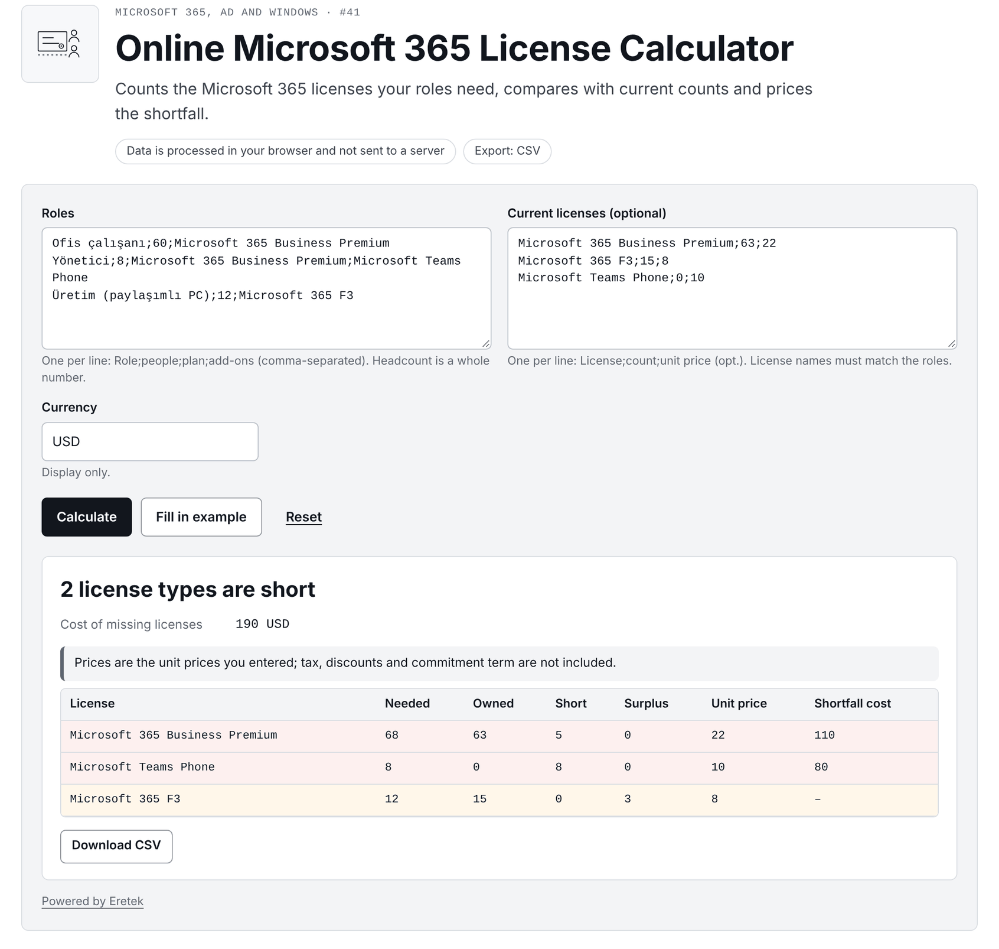

# Microsoft 365 License Calculator

Calculate Microsoft 365 plan and add-on needs from roles and headcount; see shortfall or surplus against current licenses and, with unit prices, the cost of the gap.

## Try it live

- [Türkçe](https://sistem.eretek.com/araclar/microsoft-365-lisans-hesaplama)
- [English](https://sistem.eretek.com/en/tools/microsoft-365-license-calculator)
- [Deutsch](https://sistem.eretek.com/de/werkzeuge/microsoft-365-lizenzrechner)



## What it does

Counts the Microsoft 365 licenses your roles need, compares with current counts and prices the shortfall.

In license planning one person may need several add-ons (Teams Phone, Visio, Defender) and some roles need different plans (F3, Business Premium, E3). The tool distributes roles to license types, sums identical types and returns the gap against what you own. It does not invent Microsoft prices; you enter unit prices.

## Where it helps

Before using the result as an order list, check whether shared mailboxes, meeting rooms and service accounts need licenses (Shared Mailbox Migration Planner).

## How to use it

1. Write one role per line: `Role;headcount;base plan;add-on1,add-on2`.
2. Enter current licenses as `License;count;unit price` (price optional, per user per month or per year — be consistent).
3. Enter the currency and press Calculate.

### Fields

| Field | Description |
|---|---|
| Roles | One per line: Role;people;plan;add-ons (comma-separated). Headcount is a whole number. |
| Current licenses (optional) | One per line: License;count;unit price (opt.). License names must match the roles. |
| Currency | Display only. |

## Example input

Press **Fill in example** in the tool to load this input.

| Input | Value |
|---|---|
| Currency | `USD` |

**Roles**

```text
Ofis çalışanı;60;Microsoft 365 Business Premium
Yönetici;8;Microsoft 365 Business Premium;Microsoft Teams Phone
Üretim (paylaşımlı PC);12;Microsoft 365 F3
```

**Current licenses (optional)**

```text
Microsoft 365 Business Premium;63;22
Microsoft 365 F3;15;8
Microsoft Teams Phone;0;10
```

**Expected result:** Business Premium: 68 needed, 63 owned → 5 short (110 USD); F3: 12 needed, 15 owned → 3 surplus; Teams Phone: 8 short (80 USD); total shortfall cost 190 USD.

## Method and assumptions

For each role line the headcount is added to the base plan and to every add-on; licenses with the same name (case-insensitive) are summed. Shortfall = needed − owned; shortfall cost = shortfall × unit price.

Shortfall rows without a price are excluded from the total and flagged.

## Limits and common mistakes

- Microsoft license terms (plan contents, user limits, regional prices) are not verified; you name the plans.
- Commitment term, discounts and tax are not calculated.

## Run it locally

The tool is plain HTML, CSS and JavaScript with no build step and no dependencies.

```bash
git clone https://github.com/eretek/microsoft-365-license-calculator.git
cd microsoft-365-license-calculator
node scripts/serve.js        # or: python3 -m http.server 8080
```

Open <http://127.0.0.1:8080/>. Add `?lang=tr` or `?lang=de` for Turkish or German; without it the page follows the browser language and falls back to English. You can also open `index.html` directly from disk.

Run the tests (Node.js 18 or later):

```bash
node test/run.js    # or: npm test
```

The tests run the tool's own fixtures and the worked examples in all three languages without a browser.

## How it works

All processing happens in your browser. The tool makes no network requests, uses no cookies or browser storage, and does not upload files you select.

No server-side component is needed. The version on the Eretek website renders the same page through a private WordPress plugin; that plugin only produces the page markup and is not part of this repository.

| Path | Purpose |
|---|---|
| `index.html` | Page shell |
| `src/app.js` | Builds the page in Turkish, English or German from `src/data.js` |
| `src/data.js` | Field definitions, examples and all texts in three languages |
| `src/core.js` | Shared runtime: validation, number formats, result rendering, CSV/ICS export |
| `src/tool.js` | The calculation or analysis for this tool |
| `docs/screenshot.png` | Screenshot used in this README |
| `src/tools.css`, `src/page.css` | Styles |
| `test/run.js`, `test/cases.json` | Headless tests |

## License and attribution

This tool is released under the [Eretek Website Attribution License](LICENSE). You may use, modify and redistribute it, including commercially. If you make it available on a website or web application, show a visible, clickable credit linking to https://eretek.com/ on every page where the tool is available, for example:

```html
<a href="https://eretek.com/">Powered by Eretek</a>
```

You may add `rel="nofollow"` to the link. Keep the copyright notice and license text in copies and redistributions.
